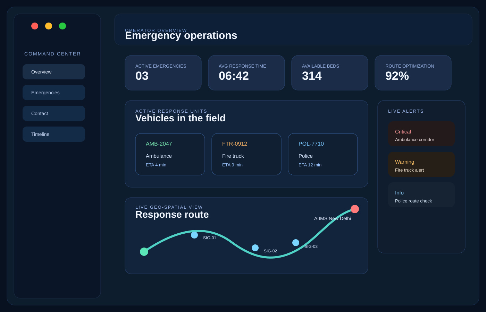
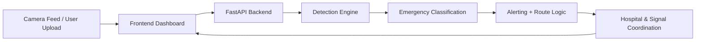
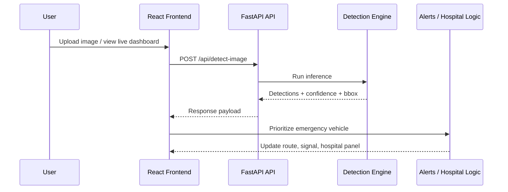
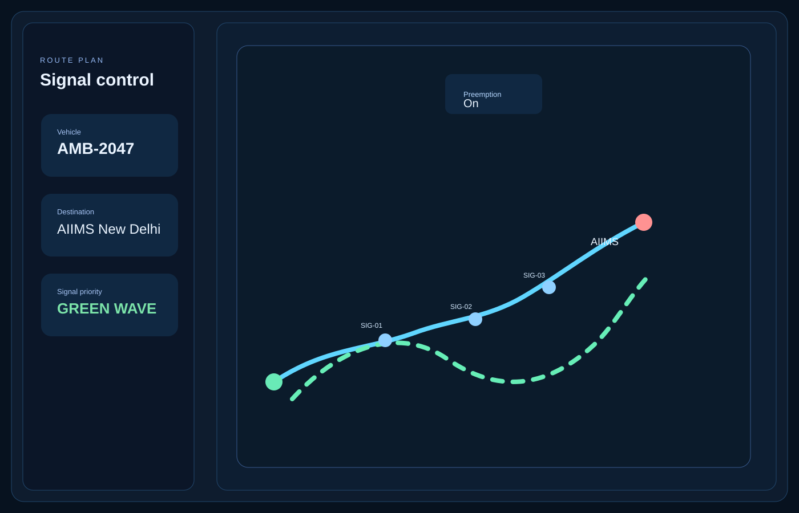
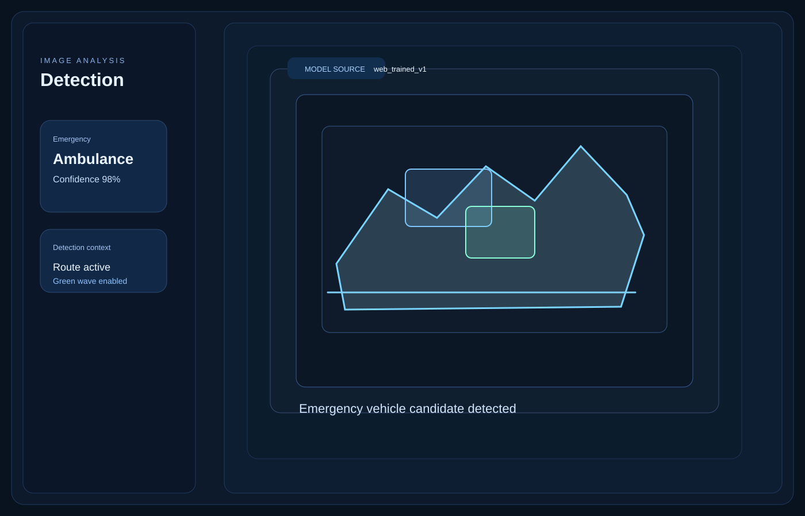

# IntelliCross

<p align="center">
  
</p>

<p align="center">
  <strong>AI-powered emergency vehicle detection and response coordination platform</strong>
</p>

A real-time emergency operations dashboard designed to detect emergency vehicles, prioritize routing, support signal coordination, and help dispatch teams make faster response decisions. IntelliCross unifies a modern frontend control room, an intelligent Python backend, and a detection pipeline that can work with uploaded images and live operational data.

---

## Why this project exists

Emergency response teams often lose critical time because of delays at intersections, congested corridors, poor hospital coordination, and limited situational awareness. IntelliCross is built to reduce that friction by combining:

- computer vision-based emergency vehicle detection
- live traffic and route status monitoring
- hospital readiness awareness
- signal preemption simulation for priority vehicles
- operator and driver-centric views for faster decisions

This project is a full-stack demo and prototype with a strong control-room interface and practical emergency response logic.

---

## Product overview

IntelliCross is a smart traffic response system for urban emergency operations. It helps operators:

- detect vehicles such as ambulances, fire trucks, and police vehicles
- track route and ETA to the nearest hospital
- monitor signal states and emergency corridor activity
- coordinate hospital alerts and response actions
- visualize operational status in one live dashboard

The platform is designed to feel like a real emergency command center without being tied to a single deployment environment.

---

## System architecture

### High-level architecture



### End-to-end workflow

| Layer | Responsibility | Key components |
| --- | --- | --- |
| Frontend | Control room UI, maps, route display, alerts, role switching | React, Vite, TypeScript, Tailwind |
| Backend | API orchestration, request handling, service responses | FastAPI, Python |
| Detection layer | Classifies emergency vehicles and extracts detections | YOLO-style inference, CV pipeline |
| Data layer | Hospitals, signals, vehicle state, corridor logic | In-memory mock datasets + backend endpoints |
| Operations layer | Alert prioritization, route recommendations | Dashboard logic, routing simulation |

### Frontend and backend interaction



---

## Real-time working model

The app does not just show static information. It behaves like a live operations console:

1. Vehicles are tracked from the dashboard with route metadata and distance-to-hospital values.
2. Emergency signals and corridor data are displayed to show which route is active.
3. Operators receive alert cards for critical or warning-level vehicle events.
4. Hospital cards show availability, response times, and emergency contact data.
5. A detection panel allows users to trigger an image analysis workflow and inspect bounding boxes and confidence scores.
6. Driver and operator views let different teams use the same system in different contexts.

### Live process flow

| Step | Event | Result |
| --- | --- | --- |
| 1 | System loads dashboard | Operator sees active vehicles, hospitals, and live signals |
| 2 | Vehicle identified | Emergency card appears with confidence and route data |
| 3 | Detection check runs | Bounding boxes and class summary appear |
| 4 | Route is assigned | Destination hospital and ETA are computed |
| 5 | Signal preemption is requested | Green wave priority is simulated |
| 6 | Hospital is alerted | Contact information and response coordination are surfaced |

---

## Screenshots and app previews

<p align="center">
  
</p>

<p align="center">
  
</p>

<p align="center">
  
</p>

> These preview graphics represent the live dashboard behavior and the image-analysis workflow used by the app. They are intentionally styled to mirror the actual control-center experience in a clean, presentation-friendly format.

---

## Key features

### Emergency vehicle detection

- Supports ambulance, fire truck, police, and disaster-related emergency classes
- Uses confidence-based detection scoring
- Shows bounding boxes around high-priority objects
- Returns structured JSON for front-end UI rendering and operational decisions

### Command center dashboard

- Operator overview with emergency counts, route optimization, and system status
- Active vehicle cards with live route and ETA details
- Hospital availability cards with beds, specializations, and emergency numbers
- Route map visualization for corridor-based operations

### Signal coordination

- Simulated traffic signal states and countdown behavior
- Corridor priority tracking for emergency movement
- Green-wave style routing logic for emergency vehicles

### Contact and escalation workflow

- Contact channels for hospitals and drivers
- Emergency call, SMS, WhatsApp, and email route generation
- Response coordination for dispatch and receiving institutions

### Driver view

- Route-focused interface for emergency drivers
- ETA and corridor visibility
- Driver-friendly status and emergency messaging flow

---

## Technology stack

### Frontend

- React
- TypeScript
- Vite
- Tailwind CSS
- Framer Motion
- Leaflet / React Leaflet
- Lucide icons

### Backend

- Python
- FastAPI
- Uvicorn
- OpenCV
- NumPy
- Pillow
- Pydantic

### AI / detection

- YOLO-style object detection pipeline
- Model loading fallback logic
- Mock detection pipeline for demo deployments
- Training-ready emergency vehicle classification workflow

---

## Project structure

```text
project/
├── README.md
├── index.html
├── package.json
├── vite.config.ts
├── tsconfig.json
├── src/
│   ├── App.tsx
│   ├── data.ts
│   ├── detection.ts
│   ├── main.tsx
│   ├── index.css
│   └── components/
│       ├── AlertTray.tsx
│       ├── ContactPanel.tsx
│       ├── DetectionPanel.tsx
│       ├── DriverView.tsx
│       ├── EmergencyHeader.tsx
│       ├── HospitalCard.tsx
│       ├── IncidentTimeline.tsx
│       ├── LiveVideoFeed.tsx
│       ├── RealTimeMap.tsx
│       ├── TrafficSignalPanel.tsx
│       └── VehicleCard.tsx
├── backend/
│   ├── main.py
│   ├── requirements.txt
│   ├── README.md
│   ├── pytest.ini
│   ├── scripts/
│   │   ├── collect_web_data.py
│   │   ├── extract_frames.py
│   │   └── train_model.py
│   └── tests/
│       ├── test_collector.py
│       ├── test_extractor.py
│       └── test_integration.py
├── docs/
│   └── screenshots/
│       ├── intellicross-dashboard.svg
│       ├── intellicross-route.svg
│       └── intellicross-detection.svg
├── .gitignore
└── .bolt/
```

---

## Backend API overview

The FastAPI service exposes routes for:

- `GET /health` — health check and model status
- `GET /api/active-emergencies` — list active emergency vehicles
- `GET /api/hospitals` — hospital metadata
- `GET /api/signals` — signal status and priority flags
- `GET /api/corridors` — corridor monitoring info
- `POST /api/detect-image` — image-based detection
- `POST /api/detect-stream` — stream/video-based detection
- `POST /api/alerts` — create internal alert messages
- `POST /api/contact` — log emergency contact actions

### Example detection response

```json
{
  "detections": [
    {
      "class_name": "ambulance",
      "class_id": 0,
      "confidence": 0.94,
      "bbox": { "x1": 100, "y1": 50, "x2": 250, "y2": 180 },
      "is_emergency": true
    }
  ],
  "top_class": "ambulance",
  "top_confidence": 0.94,
  "emergency_detected": true,
  "model_source": "base_model",
  "processing_time_ms": 42,
  "image_width": 640,
  "image_height": 480
}
```

---

## Setup and run

### Prerequisites

- Node.js 18+
- npm
- Python 3.10+
- Git

### Frontend setup

```bash
cd project
npm install
npm run dev -- --host 0.0.0.0
```

The frontend will run on:

- `http://localhost:5173`
- or on LAN using the host binding if exposed on the network

### Backend setup

```bash
cd project/backend
python -m venv venv
source venv/bin/activate   # Linux/macOS
# or on Windows:
# venv\Scripts\activate
pip install -r requirements.txt
uvicorn main:app --host 0.0.0.0 --port 8000 --reload
```

The backend health endpoint can be checked with:

```bash
curl http://localhost:8000/health
```

---

## App behavior in practice

IntelliCross is designed to simulate the decision-making flow of a live emergency control room:

- the system identifies emergency vehicles,
- routes them to the most suitable hospital,
- shows route status and signal priority,
- raises alerts for ambulance, fire, or police traffic,
- gives dispatchers a single operational picture.

This is especially useful for:

- smart city emergency planning,
- AI-based traffic coordination experiments,
- rapid prototype demonstrations,
- public-sector emergency technology research.

---

## Deployment and scalability notes

This version is optimized as a prototype / demo environment. It can be extended with:

- real camera feeds and live video streaming,
- a trained YOLO model on a custom dataset,
- database-backed alert history and event storage,
- real intersection control integration,
- cloud deployment with authentication and role-based access control.

---

## Project impact

The project demonstrates how an AI-enabled traffic command center can help reduce emergency response delays and improve operational awareness. It merges:

- computer vision,
- emergency operations management,
- route optimization thinking,
- healthcare coordination,
- and urban transportation intelligence.

It is more than a UI mockup; it represents a practical concept for real-world emergency routing and traffic-priority control.

---

## License

This project is provided for educational, research, and demonstration purposes. You may adapt and expand the system for your own developments.

---

## Contributing

Contributions are welcome for:

- better real-world detection models,
- improved routing algorithms,
- more realistic signal logic,
- richer hospital coordination flows,
- stronger production architecture and deployment patterns.

---

## Author

Built as a full-stack smart mobility and emergency response demo focused on AI-assisted dispatch coordination.

---

<p align="center">
  <strong>IntelliCross</strong><br>
  Smart emergency vehicle detection and response coordination
</p>
